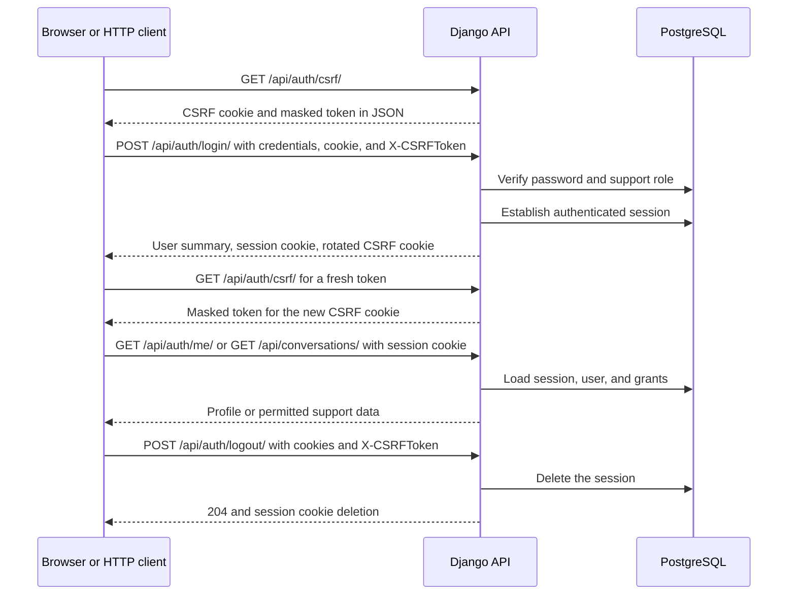

# Authentication and authorization

The `accounts` app uses Django's configured User model, username and password authentication, and database-backed sessions. The `support` app checks explicit permissions on each API operation. Both use DRF Session Authentication. The database stores users, password hashes, group membership, grants, and session records. The browser carries a host-only session cookie with an opaque identifier.

## Credentials and session lifecycle

Login checks CSRF before processing a credential submission. Django checks the password using its configured hashers and rejects inactive accounts. The API checks role eligibility before calling Django `login()`. Django rotates an existing anonymous session key when it authenticates the session and flushes a session when switching identities. It also rotates the CSRF cookie secret on login. The client fetches a fresh masked token before its next write.

Sessions expire after eight hours by default. A fresh request checks the server-side session and current account state. An expired session, deactivated account, or changed password denies access. Role and permission changes apply to subsequent requests. An authenticated user whose role was removed can still log out. Django `logout()` flushes the session, and the response clears the session cookie. [Django authentication and sessions](https://docs.djangoproject.com/en/5.2/topics/auth/default/)

## Roles and permissions

Run `python manage.py provision_support_roles` after `migrate`. Django installs default model permissions during `post_migrate`. The command can then synchronize the exact grants on the `Support Agent` and `Support Manager` groups. The command preserves memberships and unrelated groups. An authorized operator assigns group membership separately.

| Operation | Required grant | Support Agent | Support Manager | Active superuser |
| --- | --- | --- | --- | --- |
| View conversations or detail | `support.view_conversation` | Yes | Yes | Yes |
| Create a conversation | `support.add_conversation` | Yes | Yes | Yes |
| List a conversation's messages | `support.view_conversation` and `support.view_message` | Yes | Yes | Yes |
| Add an agent message | `support.view_conversation` and `support.add_message` | Yes | Yes | Yes |
| Read own support profile | Support role or active superuser | Yes | Yes | Yes |

The two groups have the same grants in this release. If a user belongs to both groups, the profile reports `support_manager`. An active superuser is explicitly eligible and reports `superuser`. The profile lists only the four supported permission codes the current account holds. Unassigned users, including ordinary staff, are denied even if they have direct grants. The group assignments never set `is_staff`, and the built-in staff flag does not determine support access. Individual endpoints still require their mapped permissions. A nested route checks the parent conversation and scopes messages to it. All authorized roles share the single-company dataset.

## CSRF, cookies, and origins

On unsafe requests Django verifies the CSRF cookie, the `X-CSRFToken` header, and the request origin when present. The login endpoint applies Django’s `csrf_protect` to anonymous requests. DRF Session Authentication enforces CSRF on authenticated writes and logout. The bootstrap endpoint returns the masked token and marks the response private and uncached. JavaScript can keep the token in memory and fetch a fresh one from the bootstrap endpoint after login. [Django CSRF protection](https://docs.djangoproject.com/en/5.2/ref/csrf/) · [DRF Session Authentication](https://www.django-rest-framework.org/api-guide/authentication/#sessionauthentication)

| Cookie | HttpOnly | SameSite | Secure |
| --- | --- | --- | --- |
| `sessionid` | Yes | `Lax` | Enabled outside `DJANGO_ENV=development` |
| `csrftoken` | Yes | `Lax` | Enabled outside `DJANGO_ENV=development` |

HttpOnly prevents JavaScript from reading either cookie. The browser still sends them automatically under its cookie policy. The two local URLs `http://localhost:3000` and `http://localhost:8000` share a site and have distinct origins. For cross-origin requests, use `fetch(url, { credentials: "include" })`. Write requests also send `X-CSRFToken`, plus `Content-Type: application/json` when there is a JSON body. Keep session identifiers and passwords out of browser storage.

`DJANGO_FRONTEND_ORIGINS` configures exact credentialed CORS origins under `/api/` and Django's trusted CSRF origins. The default development origin is `http://localhost:3000`. Outside development the allowlist defaults to empty and explicit origins must use HTTPS. CORS controls browser access to cross-origin responses. CSRF validation and backend authorization protect the operation itself. [django-cors-headers configuration](https://pypi.org/project/django-cors-headers/4.9.0/#configuration)

For deployment, use a same-origin HTTPS reverse proxy or same-site HTTPS application and API subdomains. With subdomains, add the exact frontend origin and ensure Django sees the request as HTTPS through a correctly configured, trusted proxy. Cross-site deployment would require a separate cookie and browser security review, including `SameSite=None; Secure` requirements and browser restrictions on third-party cookies.

## Limits

The login throttle allows ten CSRF-valid submissions per 60-second window per direct peer IP, counting successful, invalid, and malformed submissions. It uses a bounded process-local cache. A restart or eviction clears counters. Accounts behind the same peer address share a quota, and a reverse proxy can make all requests appear to come from one peer. Production abuse defenses require shared limits and trusted client-IP handling at the deployment boundary. MFA, SSO, user administration, customer self-service, and tenant isolation are future scope. See the [API reference](../api/endpoints.md) and [local verification procedure](../development/setup.md#inspect-the-api-locally).
