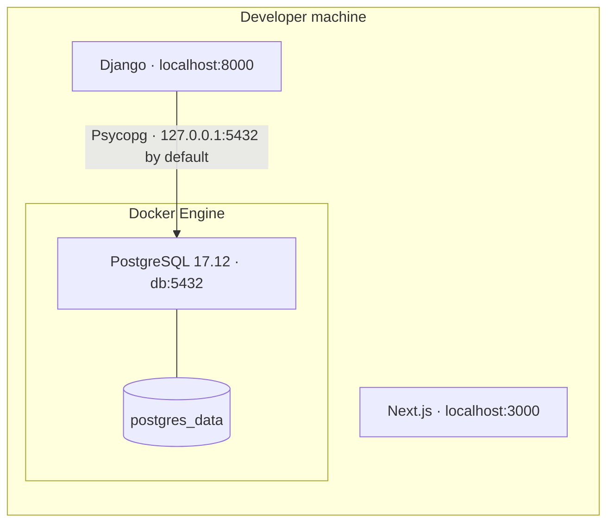

# Backend architecture

`manage.py` runs Django commands. The `config/` package holds settings, URL configuration, and ASGI and WSGI entry points. Django REST Framework handles HTTP requests under `/api/`. The backend root returns 404.

Runtime settings read process environment variables. Debug output defaults to off and allowed hosts default to loopback. Setting `DJANGO_ENV=development` allows a per-process signing key. Other runtime environments require an explicit, non-empty `DJANGO_SECRET_KEY`.

## Local database

Compose starts PostgreSQL and owns its volume. Django runs on the host and uses the `default` entry in `DATABASES`. The PostgreSQL backend translates ORM operations into SQL, passes queries through Psycopg, and opens a connection when a query needs it. Missing configuration fails during settings load. The PostgreSQL connection timeout is five seconds, and `check_database` reports a sanitized connection or query error.

A PostgreSQL server can serve multiple databases. A database contains schemas, which group tables by name. A table stores rows with named columns. A primary key identifies one row, a foreign key enforces that a referenced row exists, and an index such as one on a foreign key can speed up a lookup. Unique and other constraints enforce data rules even when writes come from different processes. PostgreSQL offers transactional writes, concurrent access, and database-enforced integrity for the planned support workflow.

## Support data

The `support` app contains the models for customers, conversations, messages, analyses, and draft responses in [`support/models.py`](../../backend/support/models.py). Its migrations live in `support/migrations/`. Conversation and message views use these models directly. See the [support data model](data-model.md) for relationships, constraints, and indexes.

The `seed_support_data` management command writes fictional customers, conversations, and messages from a deterministic inventory. Operators run it from the backend shell against local development or the isolated PostgreSQL test database. Its environment guard, transaction, and cleanup checks run independently of the HTTP request path. See the [sample data reference](../development/sample-data.md).

## Conversation and message API

`config/urls.py` mounts `support/urls.py` at `/api/`. The URL patterns dispatch to DRF generic list, create, and retrieve views. Django's model UUID lookup validates the path identifier after the permission check and maps malformed and missing UUIDs to the same JSON 404.

The views use DRF Session Authentication and check both role eligibility and the permissions mapped to the HTTP method. The nested messages view resolves and authorizes the parent once per request, then uses its related manager for list queries or passes it to the create serializer. Support roles share the single company's support data.

Read serializers select public fields. Conversation list, detail, and creation responses share a schema with a read-only customer summary. Create serializers accept only specific fields, reuse model validators, and run `full_clean()` before the atomic insert. They translate domain validation errors to HTTP 400. Scoped error handling returns a generic 500 for unexpected exceptions. API responses are private and disable caching.

The conversation queryset joins `customer` with `select_related()` and applies an optional validated status filter. Message lists filter on their parent. Both lists reuse page-number pagination and stable model ordering with the UUID as the timestamp tie-breaker. See the [API reference](../api/endpoints.md) for the HTTP contract.

## Authentication and sessions

The `accounts` app handles CSRF bootstrap, login, current-user profiles, and logout under `/api/auth/`. Django's existing authentication backend verifies usernames and hashed passwords. Django stores sessions in PostgreSQL and sends an HttpOnly session cookie. The app resolves the Support Agent and Support Manager roles from Django groups. The `support` app consumes these roles and the operation-specific model grants. See the [authentication architecture](authentication.md) for the session lifecycle, role matrix, and browser security policy.

## LLM infrastructure

The `ai` package provides a typed synchronous client, an OpenAI Responses adapter, and a fake client for tests. Services can accept the client protocol without importing OpenAI SDK types. Settings are read when a client is constructed. The management command validates configuration locally and supports an explicit live check. See the [LLM integration architecture](llm-integration.md).

`CustomerMessageClassifier` is the first AI business service. It sends one message through the client, validates the returned JSON against the seven support categories, and returns a typed result to its caller. The development command exercises it independently of HTTP and persistence. Sentiment, urgency, drafting, and orchestration remain scheduled work. See the [classification architecture](message-classification.md).

## Migrations

`makemigrations` generates versioned migration files from model changes. `migrate` applies existing migration operations and tracks them in the target database's `django_migrations` table. `showmigrations` displays that history. Review and version migration files because schema changes can lock tables or require compatible application deployments. The support app's initial migration adds its tables alongside the existing Django framework tables.

Future Django apps should group models and API code by business domain. Views should validate and authorize requests, call services for business operations, and translate outcomes into responses. Keep provider calls and response validation in dedicated AI services once introduced.

Pytest defaults to `config.test_settings` with database access disabled. The opt-in `config.postgres_test_settings` points to the loopback service and reserves a separate database for Django to create and tear down. Both modules share the framework configuration and test-only signing key. See the [testing guide](../development/testing.md).
