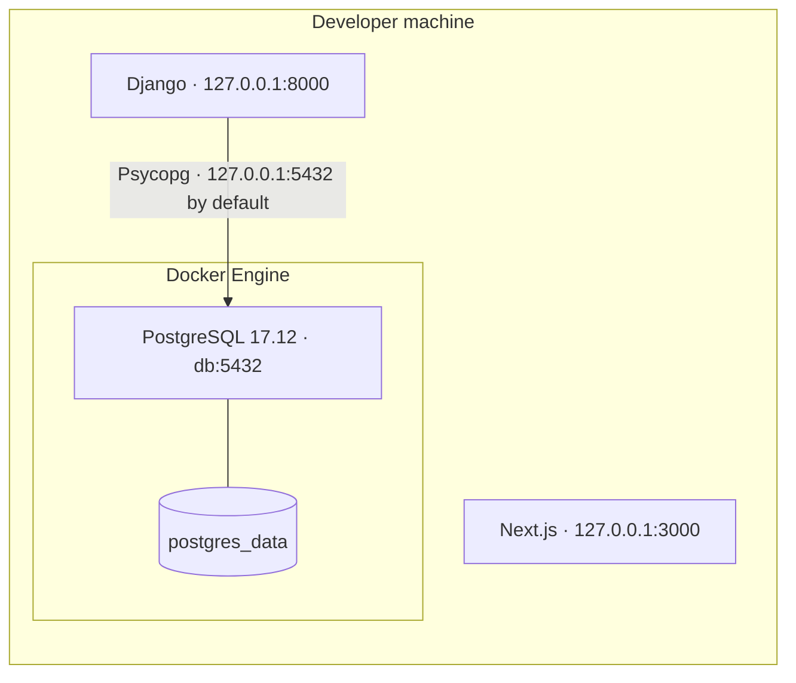

# Backend architecture

`manage.py` runs Django commands. The `config/` package holds settings, URL configuration, and ASGI and WSGI entry points. Django REST Framework is registered in `INSTALLED_APPS`. Future feature apps will use DRF for request validation, HTTP responses, and API policy. The initial URL configuration is empty.

Runtime settings read process environment variables. Debug output defaults to off and allowed hosts default to loopback. Setting `DJANGO_ENV=development` allows a per-process signing key. Other runtime environments require an explicit, non-empty `DJANGO_SECRET_KEY`.

## Local database

Compose starts PostgreSQL and owns its volume. Django runs on the host and uses the `default` entry in `DATABASES`. The PostgreSQL backend translates ORM operations into SQL, passes queries through Psycopg, and opens a connection when a query needs it. Missing configuration fails during settings load. The PostgreSQL connection timeout is five seconds, and `check_database` reports a sanitized connection or query error.

A PostgreSQL server can serve multiple databases. A database contains schemas, which group tables by name. A table stores rows with named columns. A primary key identifies one row, a foreign key enforces that a referenced row exists, and an index such as one on a foreign key can speed up a lookup. Unique and other constraints enforce data rules even when writes come from different processes. PostgreSQL offers transactional writes, concurrent access, and database-enforced integrity for the planned support workflow.

## Migrations

`makemigrations` generates versioned migration files from model changes. `migrate` applies existing migration operations and tracks them in the target database's `django_migrations` table. `showmigrations` displays that history. Review and version future migration files because schema changes can lock tables or require compatible application deployments. This task uses Django's framework migration files for auth, content types, and sessions.

Future Django apps should group models and API code by business domain. Views should validate and authorize requests, call services for business operations, and translate outcomes into responses. Keep provider calls and response validation in dedicated AI services once introduced.

Pytest defaults to `config.test_settings` with database access disabled. The opt-in `config.postgres_test_settings` points to the loopback service and reserves a separate database for Django to create and tear down. Both modules share the framework configuration and test-only signing key. See the [testing guide](../development/testing.md).
