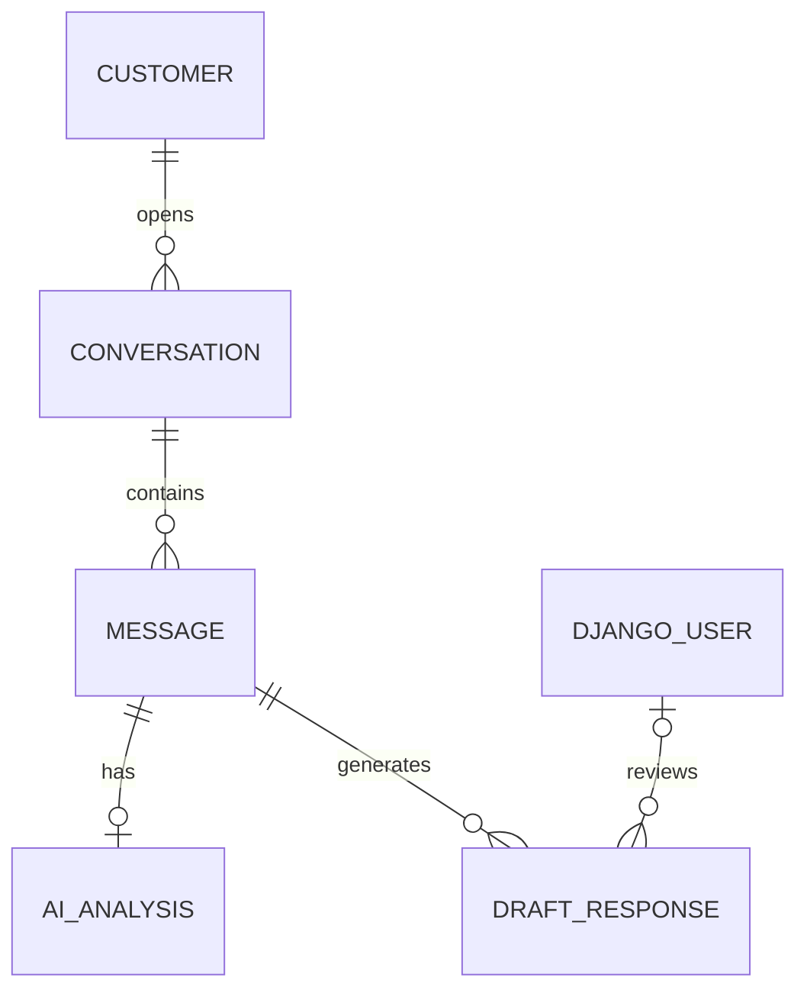

# Support data model

The `support` Django app owns the records that make up a support conversation, from the customer's messages through analysis and draft review. It lives in [`backend/support/models.py`](../../backend/support/models.py). The schema is designed for one company. A future multi-company deployment will need an explicit tenant boundary and tenant-scoped queries and uniqueness rules.

## Relationships



Every support model has a UUID primary key, generated by `uuid.uuid4` before any database access. Django sets the timezone-aware `created_at` on insert. Customer, Conversation, and DraftResponse also have `updated_at`, which Django sets on normal model saves. Queryset updates and bulk updates require the caller to set that timestamp explicitly.

## Customer

An external person contacting support. One customer can open multiple conversations through `customer.conversations`.

| Field | Type and rules |
| --- | --- |
| `name` | Required CharField, up to 200 characters. Requires a non-whitespace character. |
| `email` | Required EmailField, up to 254 characters. Django checks the format during validation. |

Validation strips surrounding whitespace and lowercases the whole address. This single-company policy treats local-part case variants as the same customer. PostgreSQL enforces uniqueness with a functional unique index on `Lower(email)`. Database checks reject blank names and empty or whitespace-padded email values. The email format check runs at the model boundary. Customers sort by name and UUID.

Conversations protect their customer from deletion. This preserves the customer reference for an existing support history. The customer string representation includes the name and UUID. Keep those values out of logs that do not need them.

```python
customer = Customer(name="Example Customer", email=" Example@Example.Test ")
customer.full_clean()
customer.save()
```

## Conversation

A ticket that belongs to one customer and groups its messages.

| Field | Type and rules |
| --- | --- |
| `customer` | Required foreign key to Customer. |
| `subject` | Required CharField, up to 255 characters. Requires a non-whitespace character. |
| `status` | Required TextChoices value. `open` requires attention and is the default. `pending` waits for action, `resolved` indicates resolution, and `closed` marks formal closure. |

PostgreSQL checks nonblank subjects, valid statuses, and the customer reference. Conversations sort newest first by creation time and UUID. Deleting a conversation through Django cascades to its messages and their analysis and draft records. The string representation includes the subject and ticket UUID.

```python
ticket = Conversation(customer=customer, subject="Delivery question")
ticket.full_clean()
ticket.save()
open_tickets = customer.conversations.filter(status=ConversationStatus.OPEN)
```

## Message

An individual entry in a conversation. Messages sort by `created_at`, then by UUID for a stable order when timestamps match.

| Field | Type and rules |
| --- | --- |
| `conversation` | Required foreign key to Conversation. The reverse accessor is `conversation.messages`. |
| `sender` | Required TextChoices value of `customer`, `agent`, or `system`. |
| `content` | Required TextField. Requires a non-whitespace character and supports up to 10,000 characters at the model validation boundary. |

PostgreSQL checks sender values, nonblank bodies, and the conversation reference. The text body is unindexed. The string representation uses the sender type and UUID. Deleting a message through Django cascades to its analysis and drafts.

```python
message = Message(conversation=ticket, sender=MessageSender.CUSTOMER, content="When will it arrive?")
message.full_clean()
message.save()
timeline = ticket.messages.all()
```

## AIAnalysis

A structured analysis associated with one customer-authored message. A message may have one current analysis through `message.ai_analysis`. The unique message reference makes the current record easy to retrieve. Tracking history or comparing multiple analyses would require a different relationship.

| Field | Type and rules |
| --- | --- |
| `message` | Required one-to-one reference to Message. Model validation checks for a customer sender. |
| `category` | Required TextChoices value of `shipping`, `refund`, `billing`, `product`, `account`, `general`, or `other`. |
| `sentiment` | Required TextChoices value of `positive`, `neutral`, or `negative`. |
| `urgency` | Required TextChoices value of `low`, `normal`, or `high`. |
| `confidence` | Optional FloatField. Accepts NULL or a finite value from 0 to 1 inclusive. This is an uncalibrated score. |
| `reason` | Optional TextField, represented by an empty string when omitted. |
| `model_name` | Required CharField, up to 200 characters, with a non-whitespace character. Stores a provider/model identifier. |

PostgreSQL enforces the one-to-one relationship, choices, nonblank model identifier, and confidence bounds. Those bounds also reject NaN and infinity in PostgreSQL. The sender rule spans two tables and runs in `full_clean()`. Bulk writes, direct SQL, and later edits to the related sender can bypass it. Deleting the parent message through Django deletes its analysis. The string representation includes category and message UUID.

```python
analysis = AIAnalysis(
    message=message,
    category=AnalysisCategory.SHIPPING,
    sentiment=Sentiment.NEUTRAL,
    urgency=Urgency.NORMAL,
    model_name="example/model",
)
analysis.full_clean()
analysis.save()
```

## DraftResponse

A proposed reply associated with a message. One message can have several proposals through `message.draft_responses`. Drafts sort newest first by creation time and UUID.

| Field | Type and rules |
| --- | --- |
| `message` | Required foreign key to Message. |
| `content` | Required TextField with at least one non-whitespace character. Model validation limits it to 10,000 characters. |
| `status` | Required TextChoices value of `pending`, `approved`, or `rejected`. Defaults to `pending`. |
| `reviewed_by` | Optional foreign key to the configured Django user model. Its database type follows that model's primary key. It is the built-in integer key in the current project. |
| `reviewed_at` | Optional timezone-aware DateTimeField. |

A pending draft requires both review fields to be NULL. Approved and rejected drafts require both fields. Model validation gives an explanatory error, and a PostgreSQL check enforces the same rules using explicit NULL checks. PostgreSQL also enforces nonblank content and both foreign keys. Reviewer deletion is protected while a reviewed draft references the account. Message deletion through Django cascades to its drafts. The string representation uses status and UUID.

```python
draft = DraftResponse(message=message, content="I can check the delivery status for you.")
draft.full_clean()
draft.save()
```

## Indexes and integrity

| Query | PostgreSQL index |
| --- | --- |
| Conversations by status, newest first | `(status, created_at DESC, id DESC)` |
| Conversations for a customer | `(customer_id, created_at DESC, id DESC)` |
| Conversation timeline | `(conversation_id, created_at, id)` |
| Current analysis for a message | Unique index from the one-to-one message field |
| Draft history for a message | `(message_id, created_at DESC, id DESC)` |
| Review queue | Partial index on `(created_at DESC, id DESC)` for pending drafts |
| Drafts that protect a reviewer | Default foreign-key index on `reviewed_by_id` |

A multi-column index covers a lookup by its leading field. The three relationships covered this way omit their separate foreign-key indexes. Each additional index adds write and storage overhead. The customer email expression index exists to enforce uniqueness.

PostgreSQL checks constraints even when an ORM write skips model validation. Call `full_clean()` in application code before saving user input because `save()` does not do it automatically. Validation covers email format, message and draft text length, and the analysis sender rule. Database checks protect shared invariants and foreign-key integrity across concurrent writers. Django applies `on_delete` policies when it collects related objects during ORM deletion. PostgreSQL foreign keys still guard direct SQL writes.

## Lifecycle and privacy

A customer opens a conversation and sends messages. A customer message can have an analysis and several draft suggestions. A draft can record who reviewed it and when. AI execution and human review workflows are planned. The schema stores the analysis fields and draft text described above. Application logs should avoid message and draft text, addresses, and provider credentials. Generated text still needs review before it is used with a customer. Retention and deletion workflows are future work.

Django migrations translate schema changes into PostgreSQL operations and record the applied state. Review generated migrations, then use the [setup guide](../development/setup.md#support-migrations) and [PostgreSQL test guide](../development/testing.md) to verify the schema and constraints against the configured engine.
