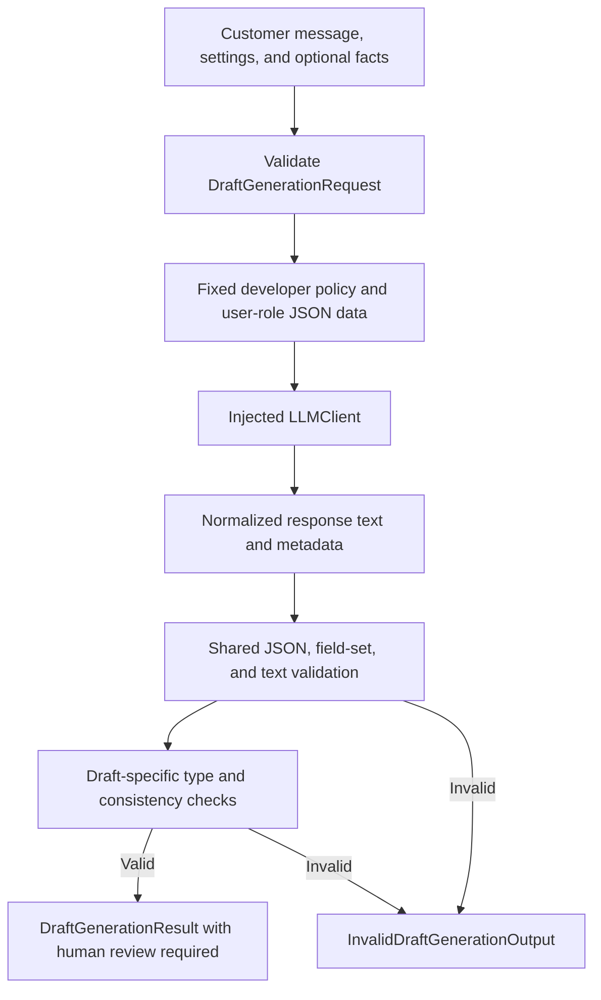

# AI draft response generation

`CustomerResponseDraftGenerator` prepares a suggested customer reply for Ternwick Circuit Supply. It uses the existing `LLMClient` and returns an immutable, in-memory result for human review.



## Request

Construct `DraftGenerationRequest(customer_message, tone=..., language=..., context=...)`, then call `generator.generate(request)`. Invalid requests raise `InvalidDraftGenerationInput` before provider invocation.

| Field | Contract |
| --- | --- |
| `customer_message` | Nonblank Unicode text of at most 10,000 characters, matching the support message limit. Original text is preserved. |
| `tone` | `professional` (default), `friendly`, or `empathetic`. Tone changes wording and keeps the same factual requirements. |
| `language` | `en` (default) or `fr`. The prompt applies the setting to the draft and the missing-information labels. |
| `context` | Optional nonblank Unicode text of at most 4,000 characters. The caller verifies the facts and supplies only details needed for the reply. |

The versioned `draft-generation-v1` developer message defines the drafting policy. The user message is a JSON object with distinct keys for the customer message, optional verified business context, language, and tone. JSON serialization preserves the original text when decoded. The caller-supplied facts and customer text have the same untrusted instruction role.

Use caller-supplied evidence for specific claims. For example, if the supplied facts confirm shipping and give a tracking reference, the draft may relay both. A delivery estimate still needs its own evidence. With an unknown refund status, the draft can ask for an order reference or explain what an agent could check. For an account problem, it can ask for the error message while keeping credentials out of the conversation. Introduce a new prompt version for material changes to these rules or the response contract.

## Output

The model returns one JSON object with these exact fields.

```json
{
  "draft_text": "Hello, could you share your order reference so our team can check?",
  "needs_information": true,
  "information_needed": ["order reference"]
}
```

- `draft_text` is one line of nonblank printable text, up to 3,000 characters. The parser rejects angle brackets, backticks, and common Markdown link and link-definition syntax.
- `needs_information` is a JSON Boolean. It is true exactly when `information_needed` has entries.
- `information_needed` is a JSON array with at most five items. Each item follows the same plain-text rules and may have up to 100 characters. Case and spacing variations count as duplicates. Valid text keeps its original spacing and case.

The shared validator rejects malformed JSON, duplicate keys, unexpected fields, and invalid text. Draft-specific checks enforce the Boolean, array, and cross-field rules. The shared 16,384-character raw JSON limit also applies, including escape sequences. Failures raise `InvalidDraftGenerationOutput` with sanitized details. Provider errors propagate as their existing `LLMError` subtypes.

`DraftGenerationResult` contains those fields with an immutable information tuple, plus the prompt version, returned provider and model, and any available token usage, request ID, and finish reason. The application supplies `requires_human_review=True` for every result. A model-supplied review or approval field fails exact-field validation.

## Cost and evaluation

The generator makes one logical request, with a maximum of 500 output tokens to fit the existing client default. A caller can choose a lower budget using `max_output_tokens`. The management command uses the lower of 500 and `LLM_MAX_OUTPUT_TOKENS`. Some models spend part of that budget on reasoning, which can cause incomplete output. Timeouts and transient retries follow the existing provider settings. Invalid outputs fail on the first response without a repair request.

Generation takes one message and any facts the caller explicitly supplies. It performs no history or policy lookup, writes no `DraftResponse` row, and has no approval or delivery operation. Treat the result as plain text and verify every business claim before using it. Role separation and structural validation constrain the request and result formats. A structurally valid draft can still contain inaccurate claims, sensitive requests, or the wrong language or tone.

Tests use `FakeLLMClient` to check the message roles, which facts were passed, and the handling of preconfigured output. Live language adherence, factual accuracy, and injection resistance remain unverified. See the [test guide](../development/testing.md#draft-generation-tests), [local command](../development/setup.md#exercise-draft-generation), and [shared validator](structured-output-validation.md).
