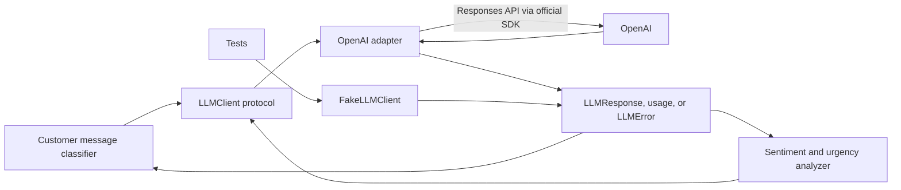

# LLM integration

The `ai` package provides a synchronous text client for backend AI services. The official OpenAI SDK sends JSON requests to `/v1/responses` and parses the provider's response. The adapter accepts project-owned types and returns project-owned types. Django discovers `check_llm` through the app registry. The application creates a client only when a caller explicitly requests one.



## Client contract

Classification, sentiment and urgency analysis, and draft generation call the same protocol independently. The client normalizes provider responses into text and metadata and owns timeouts, retries, and provider errors. Shared structured-output helpers decode the text and apply field and value rules. Each service defines its own result schema. Draft generation checks its missing-information fields together and requires human review. See the [shared validation architecture](structured-output-validation.md), [classification architecture](message-classification.md), [sentiment and urgency architecture](sentiment-urgency.md), and [draft generation architecture](draft-generation.md).

```python
from ai.client import get_llm_client
from ai.schemas import LLMMessage

client = get_llm_client()
# Calling generate with a real client can incur provider charges.
response = client.generate(
    [LLMMessage(role="user", content="Say hello in one sentence.")],
    max_output_tokens=64,
)
```

`LLMClient.generate()` takes a nonempty sequence of immutable `LLMMessage` values. Each role is `system`, `developer`, `user`, or `assistant`. Each content value must be a nonblank string. The adapter preserves content and roles so a caller can keep untrusted text in a `user` message. The request supplies no tools and asks OpenAI to disable response storage with `store=False`. See the provider documentation for data handling and retention policies. [Responses API reference](https://developers.openai.com/api/reference/resources/responses/methods/create) · [OpenAI API data controls](https://developers.openai.com/api/docs/guides/your-data)

An explicit model override replaces the configured model for one request. The configured output-token value is both the default and the ceiling for overrides. The project accepts limits from 16 through 4096. The OpenAI adapter requires `temperature=None` for every model and leaves sampling at the model's defaults. This compatibility policy keeps requests usable across model families. Model-specific settings can be introduced when a caller needs them and the selected model documents support.

The result contains the output text, provider name, reported model identifier, optional request ID, and optional `LLMUsage`. Usage separates input, output, and total tokens. Tokens are the units the provider uses to count model input and output. The output budget can include reasoning tokens. Missing usage, individual token counts, model identifiers, and request IDs use `None`. The adapter never calculates missing totals or estimates cost. The Responses API exposes completion status. The adapter uses that status to reject unfinished responses and leaves `finish_reason` as `None`. Incomplete, blank, refusal-only, or malformed outputs raise `LLMInvalidResponseError`. [Responses API reference](https://developers.openai.com/api/reference/resources/responses/methods/create) · [SDK request IDs](https://github.com/openai/openai-python/tree/v2.53.0#request-ids)

## Configuration and model choice

Configuration is read from the backend process environment when the factory or configuration check is called. An API key and model are required at that point. Django checks, PostgreSQL commands, and migrations run independently. The model identifier has no built-in value, and provider errors never cause a model substitution. OpenAI documents GPT-6 Luna as an efficient model for focused work and lists Responses API support. Use `gpt-6-luna` as an explicit example only if the API project has access. Account access and live completion remain unverified for this task. [Local setup](../development/setup.md#configure-the-optional-llm-client) · [GPT-6 Luna model documentation](https://developers.openai.com/api/docs/models/gpt-6-luna)

## Timeouts, retries, and errors

The SDK receives a timeout of 30 seconds by default. This is a per-attempt HTTP timeout applied to connection, pool, write, and read waits. It is not a total wall-clock deadline for the operation. The elapsed duration can include multiple waits, requests, and backoff intervals. [OpenAI Python SDK timeout behavior](https://github.com/openai/openai-python/tree/v2.53.0#timeouts)

The adapter disables SDK retries and limits its own retries to the configured number of additional attempts. The default is two, for at most three attempts. Eligible failures include transport errors, timeouts, ordinary HTTP 429 limits, and HTTP 500, 502, 503, or 504. Authentication, permission, quota, invalid request, malformed response, and unexpected exceptions fail immediately. For eligible failures without a provider hint, waits are 0.5, 1, and 2 seconds as the retry count increases. The adapter honors valid seconds, millisecond, and HTTP-date hints up to 10 seconds. A larger delay or a provider instruction to stop retrying ends the call. The live command sets retries to zero regardless of the environment setting.

Normalized errors distinguish configuration, authentication or access, rate limits, timeouts, connection failures, rejected requests, provider failures, and invalid responses. Each carries a sanitized message and a `retryable` classification. Retryability describes the failure class. The configured budget and provider hints still control the actual number of attempts. A timed-out request may have reached the provider. Retrying can generate another billable response. The adapter makes no exactly-once guarantee.

## Privacy and extension points

The key lives in the backend process environment. Its configuration representation omits the value, and message and response representations omit their text. The adapter and CLI emit no raw prompts, output, or authorization headers. Keep SDK wire debugging disabled for customer traffic. The adapter returns model text as data. Future callers will own input minimization, domain validation, output evaluation, and review before delivery.

Application services can accept an `LLMClient` and receive a `FakeLLMClient` in tests. The fake records typed calls and returns a predetermined response or error. Adding a provider would require an adapter that implements the same protocol plus an explicit factory branch and configuration validation. See the [testing guide](../development/testing.md#llm-client-tests).
