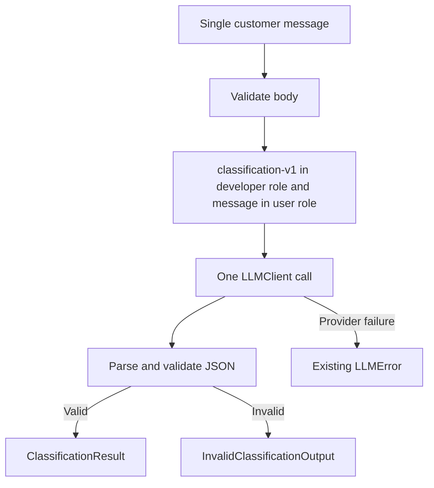

# Customer message classification

`CustomerMessageClassifier` assigns one of the seven existing support categories to a single message body. It is the first AI business service in the backend. It depends on an injected `LLMClient`, so provider calls, timeouts, and retries remain in the client layer. The classifier uses the same length limit and category enum as the support models. It operates on strings and typed results without querying or writing the database.



## Taxonomy and primary intent

| Category | Meaning | Fictional example |
| --- | --- | --- |
| `shipping` | Delivery, tracking, missing packages, or shipping delays | “My tracking number still shows label created.” |
| `refund` | Reimbursement, a return involving reimbursement, or refund status | “When will I get my money back for the returned charger?” |
| `billing` | Charges, invoices, payments, or billing errors | “I see two charges for the same order.” |
| `product` | Specifications, compatibility, features, or availability | “Does this wireless keyboard work with Linux?” |
| `account` | Login problems, account access, or settings | “I can't sign in to download my invoice.” |
| `general` | Company information, policies, hours, or support availability | “What are your weekend support hours?” |
| `other` | A request with no reasonably identifiable supported intent | “Could our repair club collect your empty cartons?” |

The requested action leads the decision. “The parcel came late and the charger is broken. I want a refund” belongs under `refund` because reimbursement is the goal. If account access prevents someone from retrieving an invoice, `account` describes the immediate obstacle. Use `other` for a message such as “Something isn't working.” A short message such as “Refund?” can still state a recognizable request. Emotion and language do not define a category.

## Prompt and input contract

`classification-v1` contains the role, category definitions, four fictional examples, the intent policy, and the JSON contract. It runs in the `developer` role. The original customer wording goes in a separate `user` message, including whitespace. The prompt instructs the model to ignore classification instructions within that user text, classify understandable messages in any language, and write a short English explanation using the English category key. Explanations should omit personal and order details.

The classifier accepts one nonblank string of up to 10,000 characters, using the support model's `BODY_MAX_LENGTH`. Unpaired Unicode surrogates are rejected before transport. The request contains the message body alone. Callers should supply only text approved for provider processing and avoid adding unnecessary personal information.

Keep published prompt behavior stable for reproducible evaluation. Introduce a new version for material changes to category definitions, intent precedence, examples, or the required output format. The result records the active version. See the [prompt record](../ai/prompts.md).

## Output and error contract

```json
{
  "category": "billing",
  "explanation": "The customer reports two charges for one order."
}
```

Classification uses the shared JSON parser and validators. Its service schema still requires exactly `category` and `explanation`, using the existing `AnalysisCategory` choices and a nonblank printable explanation of at most 300 characters. `ClassificationResult` still includes the typed category, explanation, `classification-v1` prompt version, and the provider's model, usage, and request ID when available. See the [shared validation rules](structured-output-validation.md).

Invalid inputs raise `InvalidClassificationInput`. Invalid response text raises `InvalidClassificationOutput`. Both use messages that omit the customer text and raw response. Existing normalized `LLMError` subclasses propagate to callers. A valid `other` result describes an actual classification decision. Malformed responses remain errors and cause no repair request.

## Client behavior and cost

Each successful classification path issues one logical `LLMClient.generate()` call with a default cap of 256 output tokens. It uses the configured provider model and default sampling. For an injected client with a smaller limit, pass that limit via `max_output_tokens` when constructing the classifier. The manual command uses the smaller of 256 and the configured limit. The underlying adapter may retry eligible provider failures. Longer inputs, reasoning tokens, and transport retries can increase charges. See the [LLM client policy](llm-integration.md#timeouts-retries-and-errors).

## Testing and limitations

The database-free tests use `FakeLLMClient` with fictional seed messages across all seven categories. Only message text enters the prompt. Expected labels stay in the test cases. Additional cases cover multilingual input, overlapping topics, short and emotional messages, malformed output, and instruction-like customer content. These tests verify the application contract and role boundary. They do not measure live model accuracy or resistance to prompt injection.

Valid JSON can still contain a wrong label or an inaccurate explanation. Role separation preserves the trust boundary in the request, while a model can still follow misleading text. Explanation length and format checks cannot establish factual accuracy or remove all personal information. A single message may need context, and model choices can produce different labels. Live behavior remains unverified. Formal evaluation and adversarial testing are later roadmap work. See the [classification tests](../development/testing.md#classification-tests) and [local command](../development/setup.md#exercise-message-classification).
