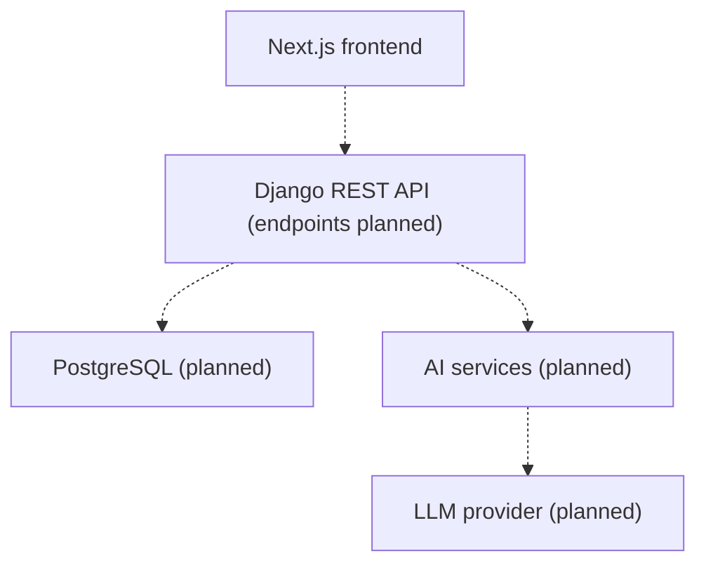

# Architecture overview

The monorepo holds two independently runnable applications. Next.js currently serves the foundation page. Django provides the backend project configuration with Django REST Framework installed and SQLite available for local checks.

The diagram shows the intended request flow. Edges, the REST endpoints, PostgreSQL, and the AI services are planned.

Keeping the two applications in one Git repository lets a future change to an API contract include the server, client, tests, and documentation in one review. See the [initial architecture decisions](../decisions/README.md).
