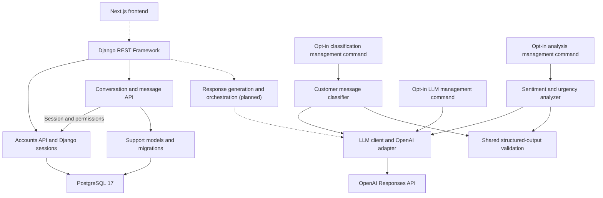

# Architecture overview

The monorepo holds two independently runnable applications. Next.js serves the foundation page. Django REST Framework serves a session authentication API and a role-protected conversation and message API. Compose defines the PostgreSQL service. See the [API reference](../api/endpoints.md), [authentication architecture](authentication.md), [support data model](data-model.md), and [progress tracker](../tasks/progress.md).

Solid edges show implemented connections. Dashed edges show planned request flow.

Keeping the two applications in one Git repository lets a future change to an API contract include the server, client, tests, and documentation in one review. See the [initial architecture decisions](../decisions/README.md).

The classifier and the sentiment and urgency analyzer use the same LLM client and validation layer and have independent management commands. See the [LLM integration architecture](llm-integration.md), [structured-output validation](structured-output-validation.md), [classification architecture](message-classification.md), and [sentiment and urgency architecture](sentiment-urgency.md).
