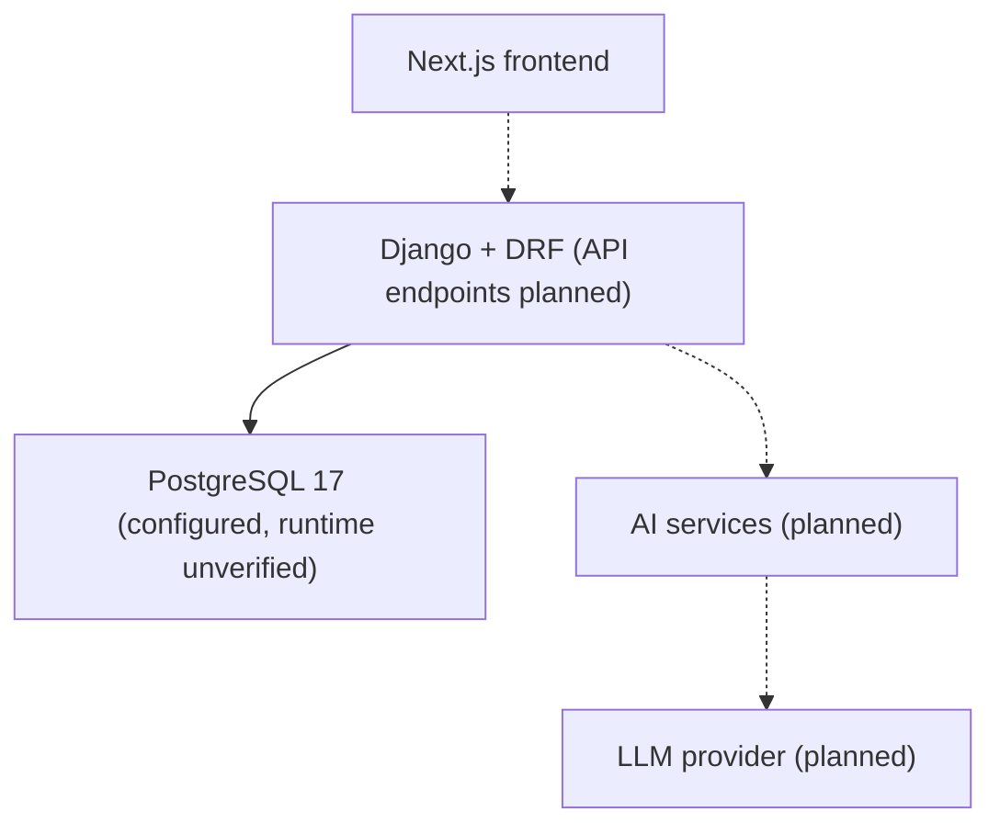

# Architecture overview

The monorepo holds two independently runnable applications. Next.js serves the foundation page. Django registers Django REST Framework and reads PostgreSQL connection settings. The Compose database service is configured. See the [progress tracker](../tasks/progress.md) for live verification status.

The solid edge shows the configured database connection. Dashed edges show planned request flow.

Keeping the two applications in one Git repository lets a future change to an API contract include the server, client, tests, and documentation in one review. See the [initial architecture decisions](../decisions/README.md).
