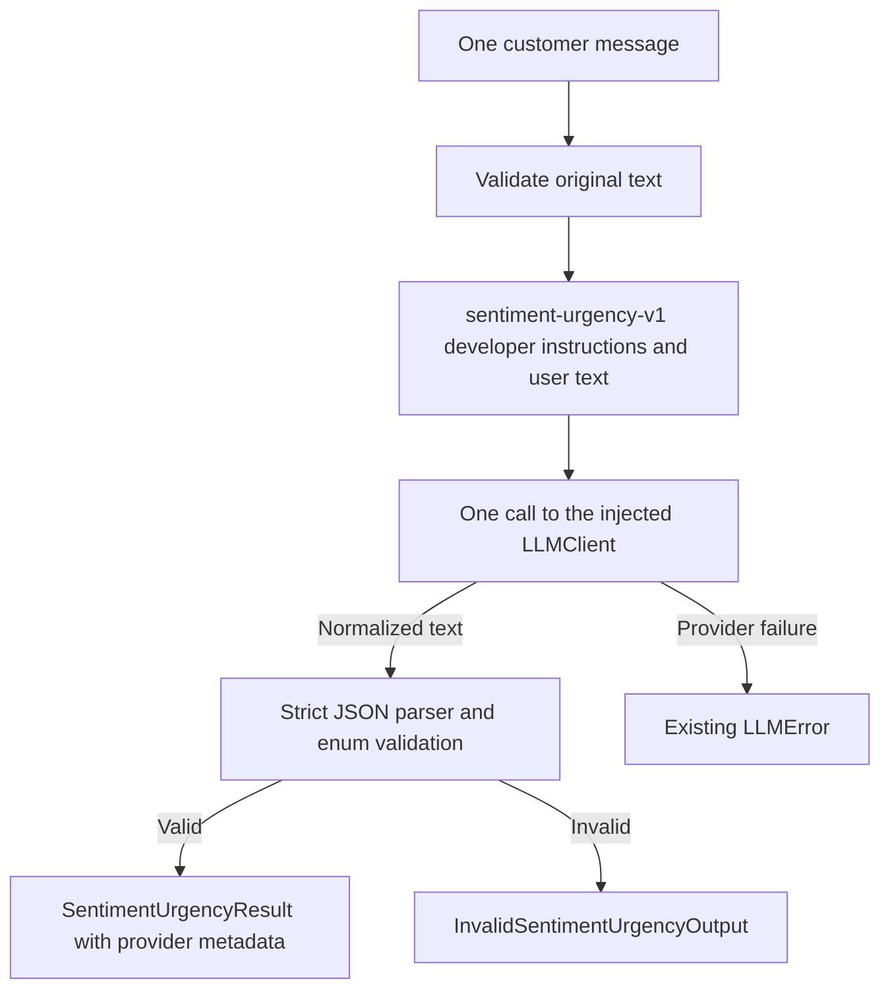

# Customer sentiment and urgency

`SentimentUrgencyAnalyzer` analyzes one customer message and returns two advisory labels with a short explanation for each. It uses the existing `Sentiment` and `Urgency` enums and an injected `LLMClient`. Both attributes share one request, which avoids sending the same text in two separate requests. Category classification remains an independent service. A future orchestration task can evaluate whether combining these services into one request reduces cost and latency at acceptable quality.



## Independent decision rules

| Sentiment | Evidence in the wording |
| --- | --- |
| `positive` | Clear appreciation, satisfaction, or enthusiasm. |
| `neutral` | Factual or informational wording, or insufficient evidence of attitude. |
| `negative` | Clear frustration, dissatisfaction, anger, or disappointment. |

| Urgency | Evidence about waiting |
| --- | --- |
| `low` | Informational or non-time-sensitive with no meaningful immediate consequence. |
| `normal` | Routine support need without a clear immediate deadline or major consequence. |
| `high` | A near deadline, immediate disruption, or clear material consequence from delay. |

Sentiment reflects the attitude expressed in the message. A delivery delay can be reported in neutral wording. Urgency reflects how much waiting matters. Evidence includes a deadline, an immediate blocker, or a serious ongoing disruption. Capitalization, anger, exclamation marks, category, and the word “urgent” alone do not establish urgency. Choose `neutral` when the attitude is unclear. For urgency, use `normal` for a routine issue and `low` for a non-time-sensitive inquiry when the message supplies no evidence for `high`.

| Fictional message | Intended sentiment | Intended urgency |
| --- | --- | --- |
| “Thank you for the excellent service!” | `positive` | `low` |
| “Your team has been fantastic. Please confirm my replacement today because I need it for tomorrow's event.” | `positive` | `high` |
| “My account is locked. I need the invoice before the finance desk closes in one hour.” | `neutral` | `high` |
| “I'm disappointed the blue mouse is unavailable. I planned to buy it next month.” | `negative` | `low` |
| “I'm frustrated about the refund delay. Could you check its status?” | `negative` | `normal` |
| “My order is two days late. Can you check its status?” | `neutral` | `normal` |

## Prompt and input

`sentiment-urgency-v1` contains the policy and six fictional examples. The fixed instructions use the `developer` role. The original message goes into a separate `user` message. The prompt requests English labels and two concise English descriptions of the relevant evidence. It uses only the supplied text, even when the customer writes in another language. The analyzer accepts a nonblank string of up to 10,000 characters, following the existing `BODY_MAX_LENGTH`, and rejects invalid Unicode before transport. Callers should use text approved for provider processing.

Keep a published version stable. Introduce a new version for material changes to criteria, examples, or the output contract. The result records the prompt version so test and evaluation results can be attributed to the instructions used. See the [prompt record](../ai/prompts.md).

## Output contract

```json
{
  "sentiment": "negative",
  "urgency": "high",
  "sentiment_explanation": "The customer explicitly expresses frustration.",
  "urgency_explanation": "The customer needs resolution before tomorrow."
}
```

The parser requires a single JSON object with exactly those four keys. It rejects malformed JSON, duplicate keys, extra fields, unsupported enum values, and blank or nonprintable explanations. Each explanation has a 300-character limit. `SentimentUrgencyResult` carries the validated attributes, prompt version, and provider metadata available from `LLMResponse`, including model, usage, and request ID. Missing metadata remains `None`. The schema contains no confidence estimate.

Invalid input raises `InvalidSentimentUrgencyInput`. Invalid response text raises `InvalidSentimentUrgencyOutput`. Errors omit raw message and response text. Normalized provider errors propagate as their existing `LLMError` subtypes. A malformed response remains an error. `neutral` and `normal` are valid model decisions when the message warrants them.

## Client behavior and cost

The analyzer sends one logical call with a default cap of 384 output tokens. The budget covers the four fields and leaves some room for model reasoning. The command uses the smaller of 384 and the configured output limit. A programmatic caller can pass `max_output_tokens` when injecting a client with a different limit. Provider settings still control the model, timeout, and bounded retries for transient failures. The analyzer does not make repair calls. Longer inputs, reasoning tokens, and transport retries can increase charges. See the [LLM client policy](llm-integration.md#timeouts-retries-and-errors).

## Testing and limitations

Deterministic tests cover all nine label combinations, overlapping tone and timing signals, the prompt boundary, strict parsing, provider errors, and CLI behavior. Tests use only the selected seed message text, with intended labels kept outside the prompt. Some expectations apply to an individual message and differ from the seed conversation's overall reference metadata.

Live accuracy and resilience to prompt injection remain unverified. Short, sarcastic, or ambiguous messages can be interpreted differently by different models. The task supplies one message, so missing history can obscure the expressed attitude or timing. Valid JSON can contain incorrect labels or sensitive details despite the prompt's privacy instructions. Treat the outputs as advice for a human reviewer. Formal evaluation and adversarial testing are later roadmap tasks. See the [testing guide](../development/testing.md#sentiment-and-urgency-tests) and [local command](../development/setup.md#exercise-sentiment-and-urgency-analysis).
