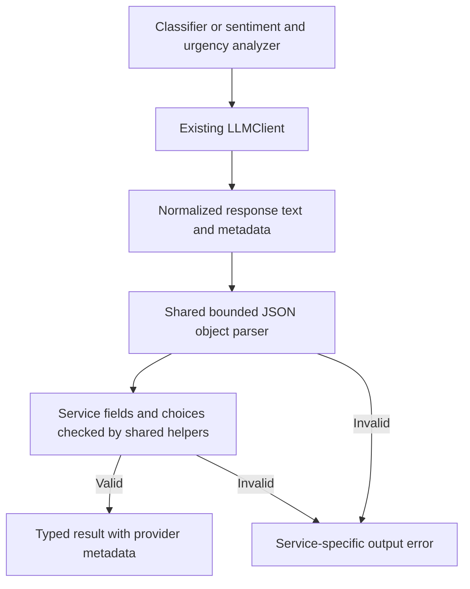

# Structured AI output validation

The `ai.structured_output` package validates text returned by the LLM. It gives classification and sentiment/urgency one place to enforce the rules they share. Each service still defines its own fields, enum choices, result type, and public errors.

## Parsing and limits

`parse_json_object()` decodes one JSON object using Python's standard `json` library. The decoder rejects syntax errors, multiple documents, wrappers such as prose or Markdown fences, and non-object roots. An `object_pairs_hook` examines keys before conversion to a dictionary. It rejects repeated keys in every object, including nested objects and keys written with equivalent Unicode escapes. This prevents one value from silently overriding another.

The parser rejects `NaN`, `Infinity`, `-Infinity`, and decimal exponents that would decode to non-finite floats. A response can contain at most **16,384 characters**, including whitespace, and **32 levels of object or array nesting**, counting the root as level one. Size is checked before decoding. Depth is checked by walking the decoded containers, and decoder recursion failures are converted to the same nesting error. These fixed limits leave room for both current response contracts, including explanations represented with JSON Unicode escapes.

## Checking a service contract

- `require_fields()` checks required and allowed keys. Required keys are the exact permitted set by default. A caller can allow additional optional keys explicitly. It reports counts of missing and unexpected keys without echoing the keys from model output.
- `validate_enum()` requires an exact, case-sensitive string choice. It accepts a collection of strings or existing Django `TextChoices`. The service decides which choices apply and constructs the typed enum member.
- `validate_text_field()` requires nonblank text, measures length in characters, and rejects nonprintable characters such as newlines, tabs, and escape characters. Valid text keeps its original Unicode and spacing. Both services set a 300-character limit for each explanation.

Classification still requests `category` and `explanation`. The sentiment and urgency analyzer still requests its two labels and two explanations. The shared package operates on parsed values and code-owned field definitions. The prompt remains responsible for semantic rules such as primary intent and independent urgency.

## Errors and compatibility

`StructuredOutputError` has three subtypes. `InvalidJSONOutput` carries a stable reason code for decoding failures and limits. `InvalidOutputShape` reports field-set failures. `InvalidOutputField` identifies the expected field whose value failed validation. Messages omit model text, unexpected key names, and raw decoder details. The parser raises after leaving the decoder exception handler, so the error chain cannot expose the full JSON document through `JSONDecodeError.doc`.

The service schemas translate shared errors into `InvalidClassificationOutput` or `InvalidSentimentUrgencyOutput`, using the established service wording for the corresponding checks. Provider errors continue through the existing LLM boundary. Service signatures, prompt versions, result fields, and metadata are preserved. The size and depth limits tighten input acceptance. Nonstandard numbers now fail during decoding, so those inputs receive the service's malformed-object message.

## Verification and limitations

Shared tests cover malformed envelopes, nested duplicate keys, exact limits, field sets, enums, Unicode text, and sanitized failures. Compatibility tests use the same fake client to check both service result shapes, existing public errors, and one logical request. The former service-specific tests are kept as regressions. See the [testing guide](../development/testing.md#structured-output-validation-tests).

Validation checks structure and supported values. A supported label or printable explanation can still be wrong or contain sensitive information. Keep the established human-review and privacy boundaries when using model results.
